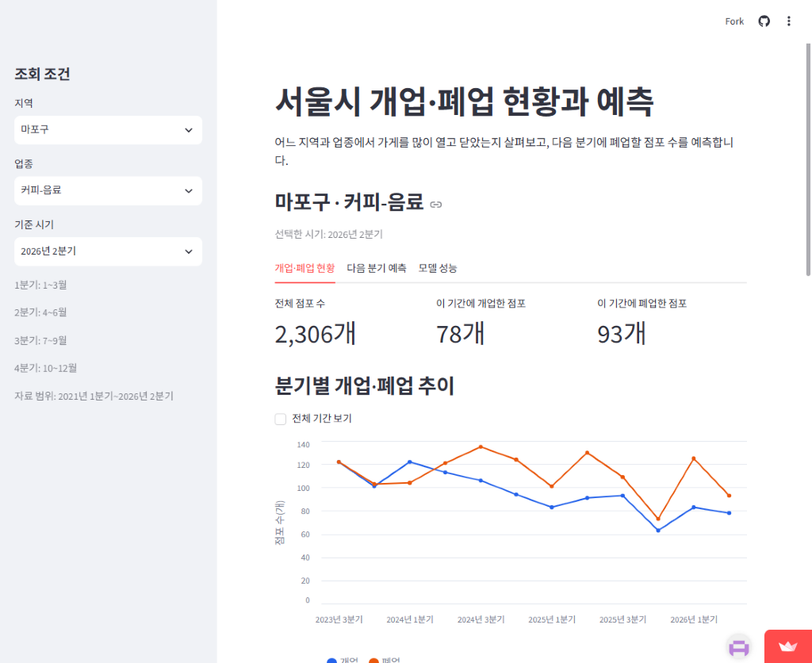

# 서울시 개업·폐업 현황 분석 및 다음 분기 폐업 예측 (`seoul-store-closure`)

서울시 자치구·업종별 점포 개·폐업 데이터를 탐색적으로 분석(EDA)하고, `scikit-learn` 회귀 모델을 활용해 **다음 분기 예상 폐업 점포 수를 예측·시각화**하는 Streamlit 대시보드 웹 서비스입니다.

- **배포 주소:** https://seoul-store.streamlit.app/
- **자료 범위:** 2021년 1분기 ~ 2026년 2분기 (`data/seoul_store_district.csv`)

---

## 실행 화면 예시



---

## 주요 기능

1. **개업·폐업 현황**
   - 사이드바에서 **자치구 · 업종 · 기준 분기**를 선택해 전체 점포 수, 개업 점포 수, 폐업 점포 수 확인
   - Altair 기반 자치구/업종별 상위 랭킹 차트 시각화
2. **다음 분기 예측**
   - 선택한 분기의 실제 폐업 점포 수와 학습된 모델(`model/closure_count_model.joblib`)의 **다음 분기 예상 폐업 점포 수** 비교
   - 과거 시점 조회 시 실제 폐업 수와 예측치 간 오차 확인
3. **모델 성능**
   - 평가 지표 요약 및 **모델별 성능 비교** 시각화

---

## 기술 스택

| 구분 | 기술 |
| :--- | :--- |
| **Web / UI** | Python, Streamlit, Altair |
| **Data / ML** | pandas, NumPy, scikit-learn, joblib |
| **Analysis** | Jupyter Notebook (`closure_analysis.ipynb`) |

---

## 프로젝트 구조

```text
seoul-store-closure/
├── data/
│   └── seoul_store_district.csv     # 서울시 자치구·업종별 점포 개·폐업 데이터
├── model/
│   └── closure_count_model.joblib   # 학습된 다음 분기 폐업 수 예측 모델
├── closure_analysis.ipynb           # 데이터 전처리·EDA·모델 비교 실험 노트북
├── closure_app.py                   # Streamlit 대시보드 메인 애플리케이션
└── requirements.txt                 # Python 패키지 의존성
```

---

## 로컬 실행 방법

```bash
pip install -r requirements.txt
streamlit run closure_app.py
```
